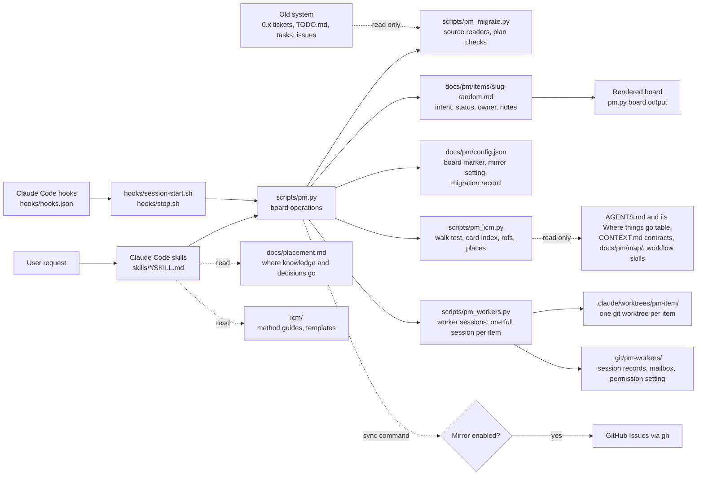
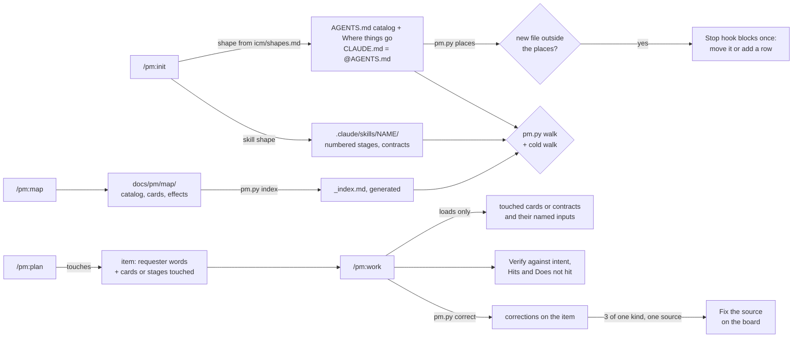
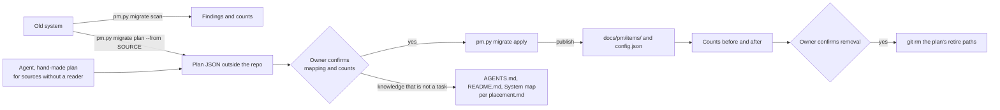

# Plugin architecture

The plugin uses Claude Code skills for conversational workflow, a Python standard-library CLI for shared board operations and worker sessions, and project-owned Markdown for state. Each board item is done by its own Claude Code worker session, started by the session the person talks to; it has no scheduled runner.

## Components and dependencies



Sources: [plugin manifest](../.claude-plugin/plugin.json), [skills](../skills/), [agents](../agents/), [CLI](../scripts/pm.py), [worker sessions](../scripts/pm_workers.py), [migration readers](../scripts/pm_migrate.py), [structure checks](../scripts/pm_icm.py), [ICM guides and templates](../icm/README.md), [hooks](../hooks/), [placement guide](placement.md), [setup and migration manual](manual.md).

## Work and data flow

```mermaid
sequenceDiagram
  actor Person
  participant Skill as /pm:work (coordinating session)
  participant Worker as worker session (full Claude Code session, pm:worker)
  participant Validator as pm:validator subagent
  participant CLI as scripts/pm.py
  participant Lock as local file lock
  participant Remote as remote default branch
  participant Item as docs/pm/items/slug-random.md
  Person->>Skill: request or start work
  Skill->>CLI: add / set / resume --answer (board writes only)
  Skill->>CLI: worker start ITEM_ID (background command), or worker brief and the app's session tool
  CLI->>Worker: claude --bg --agent pm:worker in .claude/worktrees/pm-ITEM_ID, one-line first message, model, effort, permission setting
  Worker->>CLI: worker join ITEM_ID (records session, copy, branch, prints the ticket)
  Worker->>CLI: claim / hold
  CLI->>Lock: acquire exclusive local file lock
  CLI->>Remote: fetch the latest default branch
  CLI->>Item: check and change the item in a temporary checkout
  CLI->>Remote: push the item commit without force
  Remote-->>CLI: accept one update or reject a race
  CLI->>Remote: fetch and re-check after rejection
  CLI->>Item: fast-forward the local default branch when checked out
  Worker->>Worker: build and commit the work on the work branch
  Worker->>Validator: item ID, checkout, branch, start commit
  Validator-->>Worker: VERDICT pass, or findings (fix and re-validate, at most two fix rounds)
  Worker->>CLI: validated ITEM_ID --verdict pass|findings on the work branch
  CLI->>CLI: require a current pass before finish
  Worker->>CLI: finish on the work branch, or hold with the findings
  CLI->>CLI: refuse while work is uncommitted or changed since validation
  CLI->>Item: commit the item file after the work's commits; the PR merge publishes it
  Worker-->>Skill: report at the end of its turn: result, branch, validation, checks, question
  Skill-->>Person: work result, any question, next ready item
  Person->>Skill: answer
  Skill->>CLI: resume --answer, then worker answer ITEM_ID
  CLI->>Worker: the message as the same session's next prompt (claude --resume SESSION_ID --bg, the mailbox, or the app's follow-up)
  CLI->>CLI: item Done on its branch: remove the worker's copy, keep the branch
```

`init`, `plan`, `work`, `map`, and `help` read the single [placement guide](placement.md) instead of restating it. For decisions, `hold` stores the question on the item and takes it to Waiting; `resume --answer` saves the decider's exact words at the top of `## Current notes` in the same commit as the resume, which matters because a notes edit made by hand on the default branch would block the CLI's fast-forward. Lasting decisions go on the card or contract they govern, or `AGENTS.md`, through the normal change.

The coordinating session never edits project files or claims, and never uses a subagent for ticket work; each item gets its own worker session. A worker is a full interactive Claude Code session on the person's own sign-in; no path uses print mode or the SDK. It starts one of three ways, and all three keep the same record (`scripts/pm_workers.py`):

| | Background (terminal) | App | Handover |
| --- | --- | --- | --- |
| Started by | `pm.py worker start`: `claude --bg` | the coordinating session's own session-starting tool (the Claude app's `start_session`), with what `pm.py worker brief` prints | the person, in the folder `worker start` names when `claude --bg` fails |
| Copy and branch | worktree `.claude/worktrees/pm-ITEM_ID/`, branch `pm/ITEM_ID` | made by the app, accepted as they are | worktree `.claude/worktrees/pm-ITEM_ID/`, branch `pm/ITEM_ID` |
| First message | the prompt of `claude --bg` | passed to the app's tool | handed over by the SessionStart hook |
| Turn ended | the Stop hook writes the report to the record | the app tells the coordinator; the Stop hook writes the report when the plugin's hooks run there | the Stop hook writes the report |
| Later message | the session's next prompt: `claude --resume SESSION --bg` | the coordinator's tool that messages a session it started | the mailbox: the Stop hook, still listening, wakes the open session with it |

`worker start` (run by the coordinator as a background Bash command, so Claude Code wakes it when the worker's turn ends) adds the worktree detached at the tip of the branch the board lives on (`origin/<default>` after a fetch; without a remote, the branch checked out in the main checkout) whatever the coordinating checkout has checked out, and runs `claude --bg` there with `--agent pm:worker`, `--plugin-dir` set to this plugin (a `--plugin-dir` copy replaces an installed one of the same name), the recorded exact model and effort, this clone's permission setting, and a settings file that names the item (`PM_WORKER`), runs the session's subagents on the validator's exact model (`CLAUDE_CODE_SUBAGENT_MODEL`), and keeps the session in that worktree. The started session is found by its name in `claude agents --json`. On every path the first message is one line naming `pm.py worker join ITEM_ID`, which records the session, its copy, and its branch and prints the ticket. The executable is `PM_CLAUDE` when set; otherwise `claude` on `PATH`, then `CLAUDE_CODE_EXECPATH` (the Claude Code running the session), then the usual install paths. An update replaces that file in place, so each start and answer keeps looking for up to 30 seconds before it fails with every place it looked.

Records are in `.git/pm-workers/`, the Git common directory, so every worktree and a restarted coordinator see the same ones: `sessions/ITEM_ID.json` (session, copy, branch, settings, last report) with an event log beside it, `launch/` (the settings files), and `mail/` (the mailbox); `pm.py worker list` reads them and the board. The plugin's hooks run inside a worker session (`hooks/worker.sh`): the Stop hook saves the turn's last message as the report, with the board commands and validator launches read from the session's transcript, then listens on the item's mailbox; a PermissionRequest hook records what a prompt asks. `worker start`, `answer`, and `wait` return when the record shows the turn ended, or say that the session waits on a permission prompt (only the person answers it, in that session), ended without a report, or sits idle with none. `worker answer` continues the same conversation. A background session is taken off Claude Code's session list and woken with the message as its next prompt, flags passed again; that also works after its process stopped or its copy was removed. A message is the next prompt rather than a hook's note because a prompt carries the person's authority for the session's permission setting; the mailbox serves a session that cannot be woken that way, one mid-turn or one the person opened. Worker sessions run without the scheduling tools (`--disallowedTools ScheduleWakeup CronCreate`), so a turn ends with its report. Once an item is Done on its work branch (status done with a recorded pass), the command that brought the report closes a background worker's session and removes its worktree, unless a file in it is uncommitted or its commits are on no branch; the record stays until the item is Done on the board, and `worker answer` puts the worktree back on the branch. In `auto`, when the session reports another permission mode, the CLI says so and switches the clone to `acceptEdits` for later workers. Ready items run in parallel worker sessions; a lone worker runs in the session's checkout (`--here`) so it sees files the person left there. A worker notes its start branch, claims, and creates `pm/ITEM_ID` from the branch the claim was saved on. In its own worktree it switches back to its start branch when it stops, so the work branch is free; a lone worker that finishes leaves the person's checkout on the work branch so they see the result, as before 1.3. New work never starts from that branch: before `add`, a new `claim`, or `worker start` saves or starts anything in a checkout left on another item's finished `pm/ITEM_ID` branch, the CLI returns it to the branch it was on before (read from the checkout's reflog) and says so; when that item is not finished there, or a worker is working there, those commands stop with the reason instead. `hold`, `resume`, `set`, and `correct` for another item return such a checkout the same way when they can and otherwise save where the board is. A `pm/` branch that is not an item's (such as `pm/setup`) is left alone. To wait on the owner it commits work in progress and switches back before `hold`, so the hold lands on the board's branch where the session's `resume --answer` finds it. Git status skips only embedded worktrees under `.claude/worktrees/` (the plugin's `pm-*`, and the ones Claude Code or the Claude app makes), so placement checks, `finish`, and the Stop hook still report other untracked directories.

`next` selects only queued items with no hold and with all dependencies done. Claim changes a queued item to In flight while holding the same lock used by other CLI writes; the lock file is in the Git common directory, so every worktree of a clone shares it. Claiming an item that is already in flight fails even for the same name, so two workers cannot take one item; `claim --resume` continues one's own claim after a hold or in a new session. Claim works from any branch: off the default branch it publishes through the shared default board flow and says which branch the work branch should start from. Hold and resume never change the owner, so a held claim returns to In Flight for the same person and no one else can claim it. Without a remote, the board is the main checkout's (the first entry of `git worktree list`): `board`, `next`, `add`, `claim`, `hold`, `resume`, `set`, and `correct` run there from any worktree and say which branch they saved on, while `validated` and `finish` stay on the work branch. `validated` commits the verdict to the item file there; with a remote, only shared-board commands publish through the default board flow. This is a guardrail against forgetting validation, not protection against deliberate self-approval: the CLI cannot tell who called `validated`, and the worker's session log shows each `pm:validator` launch. Finishing records a UTC completion time; the rendered board shows the newest ten Done items and counts older ones. Because each change touches only its own item file, parallel work branches merge without board conflicts.

## Structure flow (ICM)

The skills apply ICM at fixed moments so the user never runs a second skill; the method, its templates, and its MIT credit live in [`icm/`](../icm/README.md). `scripts/pm_icm.py` holds the read-only checks behind the CLI's `walk`, `index`, `refs`, and `places` commands, and `pm.py` adds `--touches` on items and `correct`.



`places` reads the `## Where things go` table of the root `AGENTS.md`: each backticked path in its Place column, cut at its first placeholder (`<`, `{`, `*`, `YYYY`), is a place, either a folder or a file such as `data/README.md`; `docs/pm/`, root dotfiles and dot-folders, and the files a tool expects at the root (`LICENSE`, the dependency and lock files) always pass. It lists the files Git reports as untracked, added, or renamed (by their new path) that fall outside every place; the Stop hook runs it with `--paths`. `validated` refuses while any non-board path is changed or new and records its verdict against the full `HEAD` SHA. `finish` requires `Validation: pass at <sha>:` and refuses if non-board commits followed that SHA, then refuses while any path outside the board is uncommitted. `walk` reads only what Git tracks or would track (`git ls-files --cached --others --exclude-standard`), so ignored build output never counts. It fails on a missing or oversized entry file, two hand-maintained entry files in one folder, links that do not resolve, a numbered stage or map contract without its five sections, an oversized `CONTEXT.md`, a workflow skill that would not package, map cards with bad frontmatter, a map of two or more cards without its change-impact index, unfilled template lines, citations past the end of a file, a verified card without its evidence, a stale `_index.md`, a `touches` path on an item that is not done that no longer exists, and one walk (entry, catalog, largest card or contract) over about 8,000 tokens; softer findings are warnings, among them an `AGENTS.md` without a Where things go table and files outside its places. `index` renders `_index.md` from card frontmatter, so it is never hand-edited. `refs` lists what points at a file before a move (links, path mentions, bare-name mentions, symlinks) and refuses a destination already taken when names are compared case-folded. `correct` appends to the item's `corrections` list through the same `publish` transaction as `hold`; counts group by kind and source across all items, and a `fixed` entry resets that group. `touches` and `corrections` are written only when set, so items without them keep their exact format.

## Migration flow

`/pm:migrate` (reached from `/pm:init` when its scan finds an existing system) moves another task system onto the board in three separate commands, so the owner confirms between reading and writing.



`scan` and `plan` only read. A reader in `scripts/pm_migrate.py` (registered in `SOURCES`: `pm-0x` and `checklist`) returns a plan: items with the requester's words verbatim, a status of queued or in-flight, an optional hold, dependencies as old keys, and an optional issue number, plus the entries left in git history, knowledge to route, warnings, and the paths to retire. Sources without a reader get a hand-made plan of the same shape. `validate_plan` rejects a malformed plan before anything is written; the rules are listed in `docs/manual.md` section 5. `apply` ends each item id with a hash of the plan's `source` and the item's `key`, so a repeat run skips items whose id ends with that hash even if the title changed, writes through the same `publish` transaction as `add`, records every key the plan accounted for (items and history) under `migrated_from.<source>` in `docs/pm/config.json`, merged into the existing settings, and prints the board's counts afterwards. No command deletes the old system; removal is a separate step the agent takes with `git rm` after the owner's yes. The `SessionStart` hook prints a one-line pointer to `/pm:init` (or `/pm:migrate` when `docs/pm/config.json` exists) while any `docs/pm/tickets/T*.md` ticket id is missing from `migrated_from.pm-0x`, and a pointer to `/pm:map` while `docs/pm/CODEBASE.md` exists without `docs/pm/map/`.

## Inputs, outputs, and external dependencies

| Component | Input | Output | Depends on |
| --- | --- | --- | --- |
| `/pm:init` | Current project and existing instructions, its shape from `icm/shapes.md` | `docs/pm/`, a catalog `AGENTS.md` with a Where things go table (and for the skill shape, a workflow skill's stages), files moved into their places only after the owner's yes, a passing walk test; hands off to `/pm:migrate` when `migrate scan` finds an existing system | Claude Code file tools, `pm.py walk` and `refs`, `icm/` |
| `/pm:migrate` | The old system, its plan edited by the owner, the owner's yes | Items written from the plan, counts before and after, knowledge routed per the placement guide, old files removed only on confirmation | `scripts/pm.py migrate`, `scripts/pm_migrate.py`, `gh` for GitHub Issues |
| `/pm:plan` | Requester's exact words, optional dependencies, touched cards or stages, decision question or answer | Queued item detail published to the shared default branch | `scripts/pm.py add`, `set`, `hold`, `resume` |
| `/pm:work` | Any project work request (added as an item first if missing) and the person's name | One separate worker session per item, parallel for ready items; each report checked against the board and branch; questions relayed and answers saved with `resume --answer` then sent to the same session with `worker answer` | `scripts/pm.py worker start`, `brief`, `answer`, `list`, `wait`, plus `add`, `next`, `board`, `resume`; Claude Code CLI |
| `pm:worker` session | Item ID, person's name, new or resume, an answer or correction | Claim before changes, new files in their places, code/doc and card updates, verify result, confirm validator-recorded verdict, recorded corrections, current item notes, committed work, then Done or a hold with the question | CLI lock, project checks, `pm.py walk`, `correct`, `hold`, `finish`, `pm:validator` subagent |
| `pm:validator` agent | Item ID, checkout path, work branch, start commit | `VERDICT: pass` or numbered findings against the requester's words, touched cards, the Where things go table (`pm.py places`), the project's checks, and commit state; edits nothing | Read-only tools and Bash, `pm.py places` |
| `/pm:status` | Project board | In flight owners, Queued, Waiting, Done, ready items, sources to fix | `scripts/pm.py board` |
| `/pm:map` | Repository source, metadata, docs, tests, an old `docs/pm/CODEBASE.md` | System map in `docs/pm/map/`: catalog, cards with citations and change impact, effects index, generated `_index.md`; the old file retired on the owner's yes; committed as its own commit, never on the default branch of a project with a remote | Claude Code read/write tools, `pm.py index`, `walk`, `refs` |
| `SessionStart` hook | Current project directory | Rendered board plus a note that any project work goes through `/pm:work`, which hands each item to a worker (the session does not edit project files itself), added work through `/pm:plan`, and new files where the table says, in session context; a pointer to `/pm:init` for an unmigrated 0.x board or an `AGENTS.md` without the table, and to `/pm:map` for a 1.0 `CODEBASE.md` | `python3`; otherwise points to `docs/pm/items/` |
| `Stop` hook | Hook payload, Git status, the Where things go table, item files | Blocks the stop once (never when `stop_hook_active`) while new files sit outside the table's places; otherwise a reminder when code changed without an item update | `git`, bash, `python3` for the place check |
| Optional `sync` | Item Markdown and GitHub repo | GitHub Issues created/updated; new issue numbers published in item files | `gh` CLI and opt-in mirror setting |

Worker session and validator model/effort defaults are recorded in `docs/pm/config.json`; worker permission mode is stored per clone under `.git/pm-workers/`. The plugin does not switch model providers. Its persistent board data is plain Markdown; the CLI uses only Python's standard library. New item IDs combine a short title slug and random suffix, with a local duplicate check; an item's file is named after its ID (older files that repeat the slug are still read). The CLI uses OS file locking (`fcntl` on Unix-like systems and `msvcrt` on Windows); its remote claim path fetches the default branch and retries ownership checks after a rejected push. See the [README](../README.md) for the user-facing collaboration and GitHub mirror contract.
