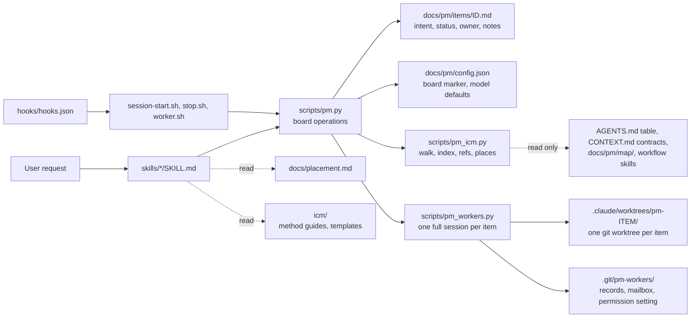

# pm manual

The one manual for the pm plugin: install it, set up a project, run work through worker sessions, share the board, and how the plugin itself is built. The [README](../README.md) is the short overview; where each kind of knowledge goes is in [placement.md](placement.md).

## 1. Install and update

```bash
claude plugin marketplace add yehezkieled/pm-plugin     # or a local path: /path/to/pm-plugin
claude plugin install pm@pm-plugin
```

Update (restart Claude Code afterwards so the new skills load):

```bash
claude plugin marketplace update pm-plugin
claude plugin update pm@pm-plugin
```

For local development of the plugin itself: `claude --plugin-dir /path/to/pm-plugin`. The helper CLI needs Python 3's standard library and Git; nothing else is installed. Without Python, the skills can still guide a manual edit of the item files, except atomic claiming, which needs the CLI.

A project still on a pm 0.x board (`docs/pm/tickets/`) is not read by this version, and session start says so in one line. Move it with the previous version first: install pm 1.5.1, run `/pm:migrate` there, then update.

Each project keeps its own board in `docs/pm/`, so installing the plugin once covers every project; setting up a project is a separate step (below). `/pm:help` prints the short command guide in any session.

## 2. A fresh project

Open Claude Code in the repository and run `/pm:init`. It:

1. Looks at the repository and runs the walk test (`pm.py walk`, read-only) to see where the structure stands.
2. Creates `docs/pm/config.json` with `pm.py init` (board writes publish through the shared board flow when a remote is configured).
3. Tells you the project's shape (2.1) in one line, and asks only when two shapes fit equally.
4. Gives the repository its structure: a small catalog `AGENTS.md` with a `## Where things go` table for that shape and a `## When you finish a task` table (2.1), and a one-line `CLAUDE.md` containing `@AGENTS.md` when absent; for the skill shape, the skill folder with its stages. Files outside the table's places are moved into them after one yes, with `out/` gitignored (a generated output already in Git leaves Git as it moves there) and, for an analysis, a `data/README.md`. An existing file is never replaced or moved without your yes (2.4).
5. Runs the walk test again and fixes the structure until it passes.
6. Shows the board and the three commands to use next: `/pm:plan` to add work, `/pm:work` to build an item, `/pm:status` to see the board.

After you approve the setup and both halves of the walk test pass, `/pm:init` commits the setup changes together on their own. With no Git remote, it commits on the current branch. With a remote, it commits on a separate setup branch (such as `pm/setup`) and asks you to open a PR; it does not commit setup changes to the default branch.

The structure follows ICM (Interpretable Context Methodology); the plugin carries the method in [`icm/`](../icm/README.md), so no other skill is needed.

### 2.1 Project shapes and where things go

Every project gets one spine, plus the rows of its shape, picked by the repeating unit of work. `/pm:init` stamps them into the `## Where things go` table of the root `AGENTS.md` (Kind of thing | Place | Rule). The full rows and tie-breakers are in [`icm/shapes.md`](../icm/shapes.md).

| | Unit of work | Places it adds to the spine |
| --- | --- | --- |
| Spine (every project) | | `docs/pm/items/` tasks, `docs/` how it works, `reports/` deliverables for people (`YYYY-MM-DD-<topic>.md`), `out/` generated (gitignored), and only `README.md`, `AGENTS.md`, `CLAUDE.md`, `.gitignore`, and the dependency file at the root |
| analysis | a question answered from data | `data/raw/<source>/`, `data/README.md`, `data/ref/`, `src/`, `tests/`, `notebooks/` |
| automation | a run | `src/`, `tests/`, `.github/workflows/`, `config/`, `out/runs/YYYY-MM-DD/`, `docs/runbook.md` |
| skill | a run of the workflow | `.claude/skills/<name>/` with numbered stages (2.3), `runs/<run>/`, `evals/` |
| app | a change to the code | `src/` (or the language's folder), `tests/`, the optional System map (2.2) |
| research | a question or a source | `sources/`, `sources/README.md`, `notes/` |

A project can be two shapes; it takes both sets of rows. A folder the project already uses keeps its name and goes in the table, and a file keeps its name when it moves. When nothing fits, the agent asks you once, recommends a place, and adds the row. Every shape gets the same board, Verify step, and fix-the-source rule (2.5); only the skill shape gets stage folders.

The table is checked, not just read. `pm.py places` lists new files outside its places, and the Stop hook asks the agent once, before it ends its turn, to move each one or ask you for a new row. `pm.py walk` warns about tracked files outside the places too.

Links keep the structure from going stale. Every Markdown file the plugin creates links what it routes to, and back up to what routes to it:

| File | Links to | Links back up to |
| --- | --- | --- |
| `AGENTS.md` › Where things go | each place that holds a file (its `README.md` when it has one); a place with no file yet, `docs/pm/items/`, and the gitignored `out/` stay plain paths | |
| a folder's `README.md` ([template](../icm/templates/folder-README.md)) | each file it describes | `AGENTS.md` |
| a stage's `CONTEXT.md` | its inputs and references | its `SKILL.md` |
| the map's `AGENTS.md`, `CONTEXT.md`, `effects/CONTEXT.md`, cards | the cards and the index | the map's `AGENTS.md`, which links the root one |

`AGENTS.md` › When you finish a task says which file a change updates: a new folder, its row and a new linked `README.md`; the first file in a place, make it a link; a folder's contents, its `README.md`; how to run the project, `README.md`; a part with a card, the card. Workers follow it before validation; the validator checks it and runs `pm.py walk`, which fails on a broken or missing link. `/pm:init` on a project set up earlier adds the missing links and the table without rewriting what is there.

### 2.2 The System map (optional)

`/pm:map` writes a map of the code that agents will change part by part:

```text
docs/pm/map/
├── AGENTS.md            # Catalog: the Names table, the clusters, where to go (CLAUDE.md is @AGENTS.md)
├── CONTEXT.md           # The map's contract: how a card is written and verified
├── _index.md            # Generated by pm.py index; never edited by hand
├── _templates/          # object.md and process.md, copied for each new card
├── objects/<cluster>/   # One card per thing: what it is, its shape (path:line), what a change hits and does not hit
├── processes/           # One card per movement that runs
└── effects/CONTEXT.md   # If you change X, open these cards
```

A card is `stub` until its facts are checked against the source, then `verified` with the date and commit, and `stale` when it falls behind. `/pm:plan` records which cards an item touches (`--touches`), `/pm:work` loads only those and updates them in the same branch, and `pm.py index` rebuilds the index. `/pm:map` ends by committing the map (everything under `docs/pm/map/`, the row in the root `AGENTS.md`, and the removal of an old `docs/pm/CODEBASE.md`) as its own commit, the way `/pm:init` commits setup: on the current branch with no Git remote, and with a remote on a separate branch (the setup branch, or one such as `pm/map`) for you to open a PR, never on the default branch.

### 2.3 The skill shape: a workflow packaged as a skill

```text
.claude/skills/<name>/
├── SKILL.md                      # name, a "Use when" description, the stage table
├── stages/01_<step>/CONTEXT.md   # Inputs, Process, Outputs, Verify, Human check
├── stages/01_<step>/references/  # Stable material that stage needs
├── _shared/                      # Material more than one stage needs
└── setup/questionnaire.md        # What a new user is asked once
runs/<run>/                       # Each run's files, outside the skill
```

`/pm:init` asks the questions in [`icm/workflow.md`](../icm/workflow.md), proposes the tree, and scaffolds it from the templates after your yes. Run outputs stay in `runs/` so the skill folder can be copied or zipped as is; the walk test checks it would package (its name matches the folder, the description has a "Use when" clause, stages are numbered and each has a contract, and no link leaves the skill).

### 2.4 An existing project, or one from an older pm

When `AGENTS.md` carries more than a catalog (over 60 lines, architecture, long procedures, a glossary), `/pm:init` runs the restructure gate: it inventories each section, finds its home in [placement.md](placement.md), runs `pm.py refs` on every file that would move (what links to it, and whether the destination is already taken when compared case-insensitively), and shows you the target tree, the migration map, and the new `AGENTS.md` in full. Only after your yes does it move files with `git mv`, check each rename is exact, update the references, and remove what you agreed to with `git rm`.

A project set up before pm 1.2 has no `## Where things go` table; it sees a one-line reminder at session start until `/pm:init` adds one. Running `/pm:init` again keeps the board and the catalog, adds the table for the project's shape with the paths it already uses, and proposes moves only for files outside it. A project from pm 1.0 with `docs/pm/CODEBASE.md` sees a one-line reminder at session start until it has a map. `/pm:map` turns that file's facts into cards, points each referrer at the map, and removes the old file on your yes. A `CONTEXT.md` used as a glossary moves into the map's Names table, since a `CONTEXT.md` is now always a folder's contract.

### 2.5 The walk test, Verify, and fixing the source

| Practice | When | How |
| --- | --- | --- |
| Walk test | After `/pm:init`, `/pm:map`, and any restructure; by every `/pm:work` worker and validator | `pm.py walk` checks the entry file's size, links (broken or missing), contracts, cards, the index, workflow packaging, and the size of one walk; then the agent answers the cold-walk questions in [`icm/method.md`](../icm/method.md) from the files alone |
| Places | Every time the agent stops; at `/pm:init` | `pm.py places` lists new files outside `AGENTS.md` › Where things go, and the Stop hook asks the agent once to move them or add a row; `pm.py walk` warns about any file outside the places |
| Validate before Done | After the worker commits and a fresh `pm:validator` checks it | The validator records its own verdict with `pm.py validated ITEM_ID --verdict pass` or `--verdict findings` and its summary on stdin; it refuses uncommitted non-board work. `finish` requires a current pass and refuses if work changed since that pass. This guards against forgetting validation; the CLI cannot identify its caller, so the worker's session log shows each `pm:validator` launch |
| Commit before Done | When a `/pm:work` worker finishes an item | The worker commits the work on the item's branch; `pm.py finish` refuses while any file outside the board is uncommitted and lists them, so Done always means committed and validated |
| Verify | Before anyone reviews a change | The worker checks the change against the requester's words and each touched card's Hits and Does not hit (a stage's Outputs and Verify); a mismatch it leaves goes at the top of the item's notes |
| Validation | After the worker commits, before `finish` | A fresh `pm:validator` subagent, started by the worker session but not the one that did the work, checks the requester's words, the touched cards, `pm.py places` and the table, the project's tests, and the commit state, and returns `VERDICT: pass` or numbered findings. The validator records its own result with `pm.py validated ITEM_ID --verdict pass` or `--verdict findings` and its summary on stdin. A pass stays attached to the verified commit; commit any fix and validate again. Still failing after two fix rounds parks the item in Waiting with the findings as the question |
| Fix the source | When the same kind of correction keeps coming back | `pm.py correct ITEM_ID --kind KIND --where PATH` records each one; at the third of one kind on one source, the CLI and the board say to change that source (a contract, card, reference file, `AGENTS.md`, or placement rule); `--fixed` records the change and resets the count |

### 2.6 Who does the work: the session and its worker sessions

The session you talk to is the coordinator, and the only session you need to read. `/pm:work` adds your request to the board (or picks the item you named, or the next ready one) and gives each item to its own worker session: a full, interactive Claude Code session (the `pm:worker` agent) with its own context in its own copy of the project, on the sign-in you already use. You can open it, watch it, and talk to it. Nothing in the plugin starts a print-mode or SDK run. The coordinator does not edit project files itself, and never uses a subagent for ticket work.

| Where you work | Who starts the worker | You open it with | Its copy and branch |
| --- | --- | --- | --- |
| Terminal | the plugin: `pm.py worker start` runs `claude --bg` | `claude attach <id>`, printed at the start | `.claude/worktrees/pm-<item>/`, branch `pm/<item>` |
| Claude app | the coordinating session, with the app's own session-starting tool (expected: `start_session`); `pm.py worker brief` prints the exact model and the one-line first message | the app's session list | made by the app; the worker's first step (`pm.py worker join`) records them |
| Background sessions blocked | you: open a session in the folder `worker start` names (the command and the app steps are printed); it gets its first message by itself | that window | `.claude/worktrees/pm-<item>/`, branch `pm/<item>` |

Each worker claims its item under your name, builds it, has a `pm:validator` subagent check it, confirms the validator's recorded verdict, then finishes it or parks it with a question. `finish` refuses if there is no pass, the verdict is findings, or non-board work changed after the pass. The CLI cannot identify who recorded a verdict; this guardrail prevents forgetting validation, while the worker's session shows each `pm:validator` launch. The coordinator checks each worker's report against the board and the branch (the report also lists the board commands the worker's session ran, the model each validator actually ran on (and says so when it is not the one you chose), and the item's state on its branch, read from the session's transcript and git rather than from the worker's own words), then tells you the result. Your answer to a worker's question goes into that same session, as its next message.

Before the first worker starts, the coordinator needs two choices that are yours, and asks for any that are missing; it never picks them. The validator subagent runs on the worker's model and effort unless you set it apart:

| Choice | Asked by | Stored | Change it with |
| --- | --- | --- | --- |
| Model and effort of worker sessions. The model is an exact version such as `claude-sonnet-5-5`; an alias like `sonnet` is refused, because it means another model once a new one ships | `/pm:init`, or `/pm:work` on a project that has none or has an alias recorded | `docs/pm/config.json` › `workers` | `pm.py defaults --worker-model M --worker-effort E` |
| Optional: another model or effort for the validator subagent (an exact version, or `inherit`, the default, for the worker's) | only when you ask for it | `docs/pm/config.json` › `validators` | `pm.py defaults --validator-model M --validator-effort E` |
| Permission setting for the worker sessions the plugin starts (a worker the Claude app starts uses the app's) | `/pm:work`, the first time in a copy of the project | `.git/pm-workers/settings.json`, this clone only | `pm.py worker mode auto` (recommended), `acceptEdits`, `default`, or `bypassPermissions` |

Name another model or effort for one item when you ask for the work, and that worker uses it (`--model`, `--effort`, `--validator-model`, `--validator-effort` on `worker start` or `worker brief`). In `auto`, a safety check approves routine edits and commands and blocks risky ones; where auto mode is unavailable, the CLI switches this clone to `acceptEdits` for the next workers and says so. Under `acceptEdits` or `default`, expect about 5 permission prompts per item: a worker's own `pm.py` and `git` commands wait for your yes, and allow rules such as `Bash(python3:*)` do not cover the shapes they take (a heredoc, a chain of commands). A worker at a permission prompt waits: the coordinator tells you what it asks and how to open that session, and you answer there. What `auto` refuses comes back in the worker's report; if you allow it, the coordinator tells that worker so.

When an item is Done on its branch, its worker's copy is removed and its background session closed, by the same command that brought the report. A copy with a file that is not committed, or commits on no branch, is kept and named; `pm.py worker remove ITEM_ID` removes it once that is settled. The branch always stays. A session the Claude app started stays in the app's list until you archive it there.

| You see | What happened | What to do |
| --- | --- | --- |
| Done, on branch `pm/ITEM_ID` (in the app: the branch the app made) | The worker committed the work and a separate check passed; its copy was removed | Review the branch; merging it publishes Done to the board |
| Waiting on your decision | The worker needed something only you have, or the separate check still failed after two fix rounds | Answer in chat; the coordinator saves your words with `pm.py resume --answer` and sends them into the same worker session with `pm.py worker answer`, which continues where it stopped |
| A worker waiting on a permission prompt | Its setting asks before an edit or a command | Open that session (the message says how) and answer there |
| A permission question from the coordinator | `auto` refused an edit or a command | Say whether that worker may run it |
| `Could not start ...'s worker as a background session` | Background sessions are not available here (blocked by policy, or no `claude` command) | Open a session in the folder it names, in a terminal or the Claude app; the worker gets its first message by itself |
| `must be an exact model version` | A model was given, or was recorded earlier, as an alias such as `sonnet` | Say which exact version you want, for example `claude-sonnet-5-5` |
| `its copy ... was kept` | The item is Done but something in the worker's copy is not committed | Commit or discard it there, then `pm.py worker remove ITEM_ID` |
| Two items running at once | Both were ready and did not depend on each other; each has its own worker session and git worktree | Merge the branches one at a time; two items that edit the same file can conflict on the second merge, so resolve it keeping both changes. An item that depends on another waits until that one is Done |
| `already has a worker session` | A second start for one item was refused | Nothing: the coordinator continues that session with `pm.py worker answer` |
| `was on pm/ITEM_ID, another item's finished work branch, so it was returned to ...` | A lone worker left your checkout on the branch of the item it finished; new work must not start from it | Nothing: the finished branch keeps its commits for you to review and merge |
| `is on pm/ITEM_ID, another item's work branch, and new work is never saved on or started from another item's branch` | That item is not finished in that checkout, or its worker is still working there | Let that worker finish or continue it; or switch the checkout to the branch new work starts from, then ask again |
| `is no longer running and left no final report` | A worker's session ended mid-turn (closed, or stopped by Claude Code) | Nothing lost: `pm.py worker answer` continues the same conversation |
| `already in flight ... another worker may be on it` | A second claim of a claimed item was refused | Nothing, unless no worker is on it: then a worker continues it with `claim --resume` |

`pm.py worker list` lists each worker session with its item, its board status, and what it is doing or waiting on. Each worker's session, copy, branch, and last report are kept in `.git/pm-workers/` of the clone, so a coordinator that restarts or loses its context finds every worker again; `pm.py worker wait ITEM_ID` reattaches to one still running and prints its report. A lone worker runs in your checkout, so it sees files you dropped there, and leaves you on its work branch when it finishes (or back on your branch when it waits on you). The next item you plan or start there first returns the checkout to the branch it was on before, so every item's branch starts from the branch the board lives on and never carries another item's commits. Without a Git remote, every worktree shares the main checkout's board. Commit or set aside unrelated edits before starting work, as a worker's branch switch carries them along. Worker sessions the plugin starts need the `claude` command: `PM_CLAUDE` when you set it, otherwise `claude` on `PATH`, the Claude Code that runs your session, or its usual install path. An update replaces it for a few seconds, so the CLI keeps looking for up to 30 seconds and then names every place it looked. No terminal multiplexer or other tool is needed.

**Not yet run on a real Claude app session (Windows).** The terminal path and the hand-opened path were run end to end with real sessions on Linux. The app path is built from what an app session said about its own tools. On the work machine, check once:

| # | Check | Expect |
| :-: | --- | --- |
| 1 | `/plugin` in an app session lists `pm`, and a new session prints the board | the plugin and its hooks load in the app |
| 2 | `/pm:work` on a small item | the coordinator runs `pm.py worker brief`, then starts a session with the app's tool (`start_session`), passing the exact model |
| 3 | Open the new session in the sidebar | its first step is `pm.py worker join`, and it answers with `Joined:` and a `Work branch:` that is the app's own branch |
| 4 | Let it finish | the coordinator is told the turn ended, `pm.py worker wait` shows `Report:`, and the app-made copy is removed while its branch stays |
| 5 | Give an item that must ask you something | your answer reaches the same session as a follow-up message |
| 6 | `python3 --version` in the app's shell | if missing, `python` or `py` works for `pm.py`; the session-start and stop hooks need Git for Windows (Git Bash) and `python3` |

## 3. The board and how it is shared

The item files in `docs/pm/items/` are the only board state in Git. `pm.py board` renders In flight, Queued, Waiting, and the latest ten Done items on demand (older Done items are counted); no generated file is committed. `pm.py next` lists queued items with no hold whose dependencies are all Done.

- **Publishing.** With a remote, `add`, `set`, `hold`, `resume`, `claim`, and `correct` commit the item file and push it to the default branch, so every clone sees the same items. Each write takes a file lock in the Git common directory (shared by every worktree of a clone), fetches the default branch, changes the item in a temporary checkout, and pushes without force; a rejected push is fetched and re-checked. A checked-out default branch is fast-forwarded afterwards. `validated` and `finish` stay on the work branch; its merge publishes Done.
- **No remote.** The board is the main checkout's (the first entry of `git worktree list`): board commands run there from any worktree and say which branch they saved on, so parallel workers see each other's claims.
- **Claims.** Claiming moves a queued item to In flight under the person's name. A second claim of an item in flight fails, even under the same name; `claim --resume` continues one's own claim after a hold or in a new session. Claim works from any branch and says which branch the work branch should start from.
- **Holds and decisions.** `hold` parks an item in Waiting with its question and keeps its owner; `resume` returns a claimed item to its owner In flight and an unclaimed one to Queued. `resume --answer` appends the decider's exact words to the item's `## Decisions`, which the worker never rewrites and `finish` keeps in the Done item, in the same commit (a hand edit of the item on the default branch would block the CLI's fast-forward). Items from before 1.5.1 keep their `Decision on` lines in the notes. Lasting decisions go where [placement.md](placement.md) says.
- **Done.** `validated` records a verdict against the full `HEAD` SHA and refuses while non-board work is uncommitted. `finish` needs `Validation: pass at <sha>:`, refuses if non-board commits followed that SHA or anything outside the board is uncommitted, and records a UTC completion time.
- **Merging.** Each change touches only its own item file, so parallel work branches merge without board conflicts.

Item IDs are a short title slug plus a random suffix, checked against existing IDs; the file is named after the ID. `touches` and `corrections` are written only when set, so other items keep their exact format.

## 4. Hooks

| Hook | What it does |
| --- | --- |
| Session start | Prints the board, then one note: any project work goes through `/pm:work` and its worker sessions, not edits in this session; work to add goes through `/pm:plan`; every new file goes where `AGENTS.md` › Where things go says. A worker session gets a note naming its item instead. One-line pointers: to `/pm:init` while `AGENTS.md` has no Where things go table or no When you finish a task table, to `/pm:map` while an old `docs/pm/CODEBASE.md` has no System map, and to pm 1.5.1 for a pm 0.x board. Without `python3` it only says where the items are. |
| Stop | A new file outside the table's places sends the agent back once (never when `stop_hook_active`) to move it or ask for a row; otherwise it reminds the agent when code changed without an item update. Nothing else blocks a session. |
| Worker hooks (`hooks/worker.sh`) | Act only inside a worker session: the Stop hook saves the turn's report and listens on the item's mailbox; a PermissionRequest hook records what a prompt asks. |

## 5. How the plugin is built

Skills hold the conversational workflow, a Python standard-library CLI does every board write and runs worker sessions, and the project's own Markdown holds the state. There is no scheduled runner.



| File | Role |
| --- | --- |
| [`skills/`](../skills/) | `/pm:init`, `plan`, `work`, `status`, `map`, `help` |
| [`agents/worker.md`](../agents/worker.md), [`validator.md`](../agents/validator.md) | The worker session's instructions; the read-only check before Done |
| [`scripts/pm.py`](../scripts/pm.py) | Board commands, defaults, and the `worker` commands' entry point |
| [`scripts/pm_workers.py`](../scripts/pm_workers.py) | Starting, answering, and tidying worker sessions |
| [`scripts/pm_icm.py`](../scripts/pm_icm.py) | `walk`, `index`, `refs`, `places` |
| [`icm/`](../icm/README.md) | The ICM method, the project shapes, the templates the skills follow |
| [`hooks/`](../hooks/) | The hooks in section 4 |

### Worker sessions inside

`worker start` (run by the coordinator as a background Bash command, so Claude Code wakes it when the worker's turn ends) adds the worktree detached at the tip of the branch the board lives on (`origin/<default>` after a fetch; without a remote, the branch checked out in the main checkout), and runs `claude --bg` there with `--agent pm:worker`, `--plugin-dir` set to this plugin (a `--plugin-dir` copy replaces an installed one of the same name), the exact model and effort, this clone's permission setting, and a settings file that names the item (`PM_WORKER`), keeps the session in that worktree, and runs its subagents on the validator's model: the worker's own for `inherit` (`CLAUDE_CODE_SUBAGENT_MODEL`; `agents/validator.md` names no `model:`, which would outrank it). The started session is found by its name in `claude agents --json`. On every path (background, app, handover) the first message is one line naming `pm.py worker join ITEM_ID`, which records the session, its copy, and its branch and prints the ticket.

Records live in `.git/pm-workers/` (the Git common directory, so every worktree and a restarted coordinator see them): `sessions/ITEM_ID.json` with an event log beside it, `launch/` (settings files), and `mail/` (the mailbox). The Stop hook's report adds the board commands and validator launches read from the session's transcript and the model each validator ran on from its subagent transcript, so a wrong self-report shows. `worker answer` continues the same conversation: a background session is taken off Claude Code's session list and woken with the message as its next prompt (`claude --resume SESSION --bg`), which also works after its process stopped or its copy was removed; a message is a prompt rather than a hook note because a prompt carries the person's authority for the permission setting. The mailbox serves a session mid-turn or one the person opened. Worker sessions run without `ScheduleWakeup` and `CronCreate`, so a turn ends with its report. In `auto`, when a session reports another permission mode, the CLI switches the clone to `acceptEdits` for later workers and says so.

Before `add`, a new `claim`, or `worker start` saves or starts anything in a checkout left on another item's finished `pm/ITEM_ID` branch, the CLI returns it to the branch it was on before (from the checkout's reflog) and says so; when that item is not finished there, or a worker is working there, it stops with the reason. A `pm/` branch that is not an item's (such as `pm/setup`) is left alone. Git status skips only embedded worktrees under `.claude/worktrees/`.

### Structure checks

`places` reads the `## Where things go` table of the root `AGENTS.md`: each backticked path in its Place column, cut at its first placeholder (`<`, `{`, `*`, `YYYY`), is a place; `docs/pm/`, root dotfiles and dot-folders, and the files a tool expects at the root (`LICENSE`, dependency and lock files) always pass. It lists files Git reports as untracked, added, or renamed outside every place; the Stop hook runs it with `--paths`. `walk` reads only what Git tracks or would track. It fails on a missing or oversized entry file, two hand-maintained entry files in one folder, broken links, a place in `## Where things go` that holds a file but is not linked from its row, a folder `README.md` the table links or a nested `AGENTS.md` or `CONTEXT.md` that does not link back up to its catalog, a numbered stage or map contract without its five sections, an oversized `CONTEXT.md`, a workflow skill that would not package, map cards with bad frontmatter or unverified evidence, a map of two or more cards without its change-impact index, unfilled template lines, citations past the end of a file, a stale `_index.md`, a `touches` path that no longer exists on an item not done, and one walk over about 8,000 tokens; softer findings are warnings. `index` renders `_index.md` from card frontmatter. `refs` lists what points at a file before a move and refuses a destination already taken when names are compared case-folded. `correct` counts corrections by kind and source across items; a `fixed` entry resets that count.

The CLI uses OS file locking (`fcntl`, or `msvcrt` on Windows) and only Python's standard library. To check a change to the plugin: `python3 -m unittest discover -s tests -v`; for skill routing on real models, [`evals/README.md`](../evals/README.md).

## 6. When something looks wrong

| Symptom | Cause and fix |
| --- | --- |
| A board command says the local default branch cannot fast-forward | Sync the default branch with the remote first; every board change is published the same way |
| Session start mentions a pm 0.x board | This version does not read `docs/pm/tickets/`. Install pm 1.5.1, run `/pm:migrate` there, then update |
| `pm.py walk` fails | Each FAIL line names the file and what to fix; WARN lines do not fail it. Fix and run it again; `/pm:init` and `/pm:map` do this themselves |
| "_index.md is missing or out of date" | A card was added, renamed, or changed status. Run `pm.py index`; never edit `_index.md` by hand |
| "Item ... touches paths that do not exist" | A card or stage folder an item that is not done points at moved. Update the item with `pm.py set ITEM_ID --touches PATH,PATH` |
| `pm.py refs` says the destination is taken | Another file has the same name apart from letter case, which breaks on macOS and Windows checkouts. Pick another name |
| The board ends with "Fix the source" | The same correction was made three times on one source. Change that source, then record it with `pm.py correct ... --fixed` |
| Session start mentions `docs/pm/CODEBASE.md` | The project predates the System map. Run `/pm:map` to convert it (2.4) |
